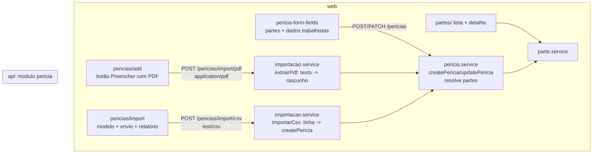

# Importação de processos — Design

**Spec**: `.specs/features/importacao-processos/spec.md`
**Decisões**: AD-114 (PDF por regras), AD-115 (defaults da importação), AD-116 (escopo P1+P2), AD-117 (partes como cadastro), AD-118 (arquivo no corpo da requisição, número CNJ define justiça e tribunal)
**Status**: Approved (2026-10-31, respostas do usuário às três perguntas do protocolo)

---

## Architecture Overview

Tudo fica no módulo `pericia` (dono de `Pericia`, `Prazo` e agora `Parte`): nenhum outro módulo muda de dependência.

### Partes (IMP-03, AD-117)

- Uma collection `Parte` com `tipo: 'party' | 'lawyer'`, `nome`, `documento` (CPF/CNPJ só dígitos, parte), `oab` (maiúsculas sem espaço, advogado), `email`, `telefone`. Um cadastro só, em vez de dois models, porque a tela, a busca e a regra de reaproveitamento são as mesmas.
- A perícia guarda `partes: [{ Parte, polo: 'plaintiff' | 'defendant', tipo, nome }]`. O `nome` é cópia do cadastro para a busca da listagem (Atlas Search em `partes.nome`) e para o resumo do feed/aviso sem segunda consulta; renomear a parte atualiza as cópias com um `updateMany` + `arrayFilters`. Vários réus e vários advogados por polo cabem no mesmo array.
- `autor` e `reu` (texto) **saem** do model, do contrato e do índice de busca. `PericiaResumo` mantém `autor`/`reu` como texto derivado das partes (nomes do polo, tipo `party`, separados por vírgula), então feed e aviso não mudam.
- Entrada (`createPericiaSchema`/`updatePericiaSchema`): `partes: [{ parteId?, polo, tipo, nome, documento?, oab? }]`. Com `parteId` usa o cadastro (do tenant; inexistente ⇒ 400). Sem `parteId`: reaproveita por `documento` (parte) ou `oab` (advogado); sem eles, por `nome` exato (espaços normalizados) e `tipo`; senão cria (AD-115). No PATCH, `partes` informado substitui a lista inteira.
- Rotas `/partes` (lista com busca e filtro de tipo, criar, detalhe, editar, perícias da parte), todas `canOperate` (AD-107: operação é de qualquer papel). Sem exclusão nesta rodada.

### Dados trabalhistas (IMP-04)

Campos opcionais na perícia, datas `YYYY-MM-DD` (AD-103): `dataAutuacao`, `dataAdmissao`, `dataDemissao`, `periodoImprescritoInicio`, `periodoImprescritoFim`; texto: `funcaoReclamante`, `localPericia`. A API aceita em qualquer justiça; o formulário só mostra o grupo quando `justica = labor`.

`sugerirPeriodoImprescrito({ dataAutuacao, dataAdmissao, dataDemissao })` em `packages/contracts/src/schemas/pericia.schema.ts` (função pura, usada pela API e pelo web): início = mais recente entre (autuação − 5 anos) e admissão; fim = demissão, ou a autuação quando não há demissão. Sem autuação ⇒ sem sugestão. `createPericia` grava a sugestão quando o período vem vazio (vale para formulário, PDF e CSV); na edição o formulário mostra "Usar período sugerido".

### PDF (IMP-01, AD-114, AD-118)

- `POST /pericias/import/pdf` com o arquivo no corpo (`Content-Type: application/pdf`, `express.raw` só na rota, limite 10 MB). Assinatura `%PDF-` conferida; outro tipo ⇒ 415 `unsupported_file_type`; maior que o limite ⇒ 413 `file_too_large`. O arquivo não é gravado.
- Texto extraído com `unpdf` (`extractText`, pdf.js empacotado para Node). Sem camada de texto ⇒ 422 `pdf_without_text` (sem OCR).
- `extrairAta(texto)` (função pura, testada com textos de ata/despacho): número CNJ (primeiro; mais de um ⇒ aviso `multiple_process_numbers`), justiça e tribunal pelo número (`J`=5 TRT, 4 TRF, 8 TJ por UF), vara, comarca/cidade, objeto (rótulo "Objeto"/"Assunto" ou insalubridade/periculosidade/médica/contábil/engenharia), partes e advogados pelos rótulos do PJe (`RECLAMANTE`, `RECLAMADO`, `AUTOR`, `RÉU`, `ADVOGADO … OAB`), CPF/CNPJ ao lado do nome, data de nomeação (data por extenso ou `dd/mm/aaaa` do documento) e prazo do laudo (data explícita, ou "prazo de N dias" contado da nomeação em dias corridos com aviso `deadline_calculated`).
- Resposta (não persiste): `{ draft, missing, warnings, existingId? }`. `draft` tem o formato de `CreatePericia`; `missing` lista os campos obrigatórios/esperados não achados; número inválido ⇒ aviso `invalid_process_number`; número já cadastrado ⇒ `existingId` e aviso `expert_case_already_registered`. O web preenche o formulário de `add`, mostra o que falta e o perito salva pelo `POST /pericias` de sempre.

### CSV (IMP-02, AD-115, AD-118)

- `POST /pericias/import/csv` com o texto no corpo (`Content-Type: text/csv`, `express.text`, limite 2 MB, até 1000 linhas de dados). BOM removido; separador `;`; aspas duplas para campo com `;` ou quebra de linha.
- Colunas em `CSV_IMPORT_COLUMNS` (`packages/contracts/src/schemas/importacao.schema.ts`), fonte única do modelo que o web gera para download e do parser da API. Justiça e tribunal vêm do número CNJ; `papel` aceita `perito`/`assistente` (vazio ⇒ perito); datas `DD/MM/AAAA` ou `AAAA-MM-DD`; dinheiro `1.500,00`.
- Cada linha vira um `CreatePericia` validado pelo `createPericiaSchema` e criado por `createPericia` (mesmo caminho do formulário: prazo do laudo, partes, período imprescrito). Linha inválida ⇒ `rejected[{ line, column?, reason }]` (chave de mensagem em inglês, AD-113); número já cadastrado (inclusive repetido no próprio arquivo) ⇒ `skipped[{ line, numeroProcesso }]`; o lote não para.
- Cabeçalho ausente/coluna obrigatória faltando ou arquivo sem linhas ⇒ 400 `csv_invalid_header`/`csv_empty` (arquivo inteiro recusado).

### Web

- `apps/web/src/lib/api/client.api.ts`: `postFile(path, file)` envia o arquivo como corpo com o `type` dele.
- `pericias/add`: ação "Preencher com PDF" (input de arquivo) → `form.reset` com o rascunho + painel com faltantes e avisos (link para a perícia existente).
- `pericias/import/`: página nova (Card asPage) com o formato, "Baixar modelo", envio do CSV e relatório (criadas/ignoradas/recusadas + tabela de linhas). Acesso pelo `PageMenu` da listagem.
- `pericia-form-fields`: partes por `useFieldArray` (polo, tipo, nome com sugestões do `GET /partes`, documento ou OAB) e o grupo trabalhista; detalhe mostra partes e dados trabalhistas no `ProductSpecs`.
- `partes/`: listagem (busca + filtro de tipo + criar em `FormDialog`) e `details/?id=` (dados, edição, perícias). Entra no grupo "Trabalho" da navegação.

---

## Code Reuse Analysis

| Existente | Onde | Uso |
| --- | --- | --- |
| `numeroProcessoSchema`, `calendarDateSchema` | `packages/contracts/src/schemas/{pericia,date}.schema.ts` | validação de cada linha e do rascunho |
| `createPericia` (prazo do laudo, 409 de duplicado) | `apps/api/src/modules/pericia/pericia.service.ts` | único caminho de criação para formulário, PDF e CSV |
| `periciaSearchStages` / `SEARCH_INDEXES` | `packages/db/src/textSearch.ts` | `partes.nome` no índice da perícia; índice novo `parte_text` |
| `DATAJUD_TRIBUNAIS` | `packages/contracts/src/schemas/prospeccao.schema.ts` | não reaproveitado: lista só tribunais atendidos; o mapa `TR → UF` do CNJ é fixo e mora em `importacao.service` |
| `FormDialog`, `ProductSpecs`, `LinkList`, `DataTable`, `form-fields` | `apps/web/src/components/` | telas de partes e importação |

## Fora deste design

OCR, IA no servidor (AD-114), exclusão e mesclagem de partes, mais de uma parte por polo no CSV (uma parte e um advogado por polo; o resto se ajusta na tela).
