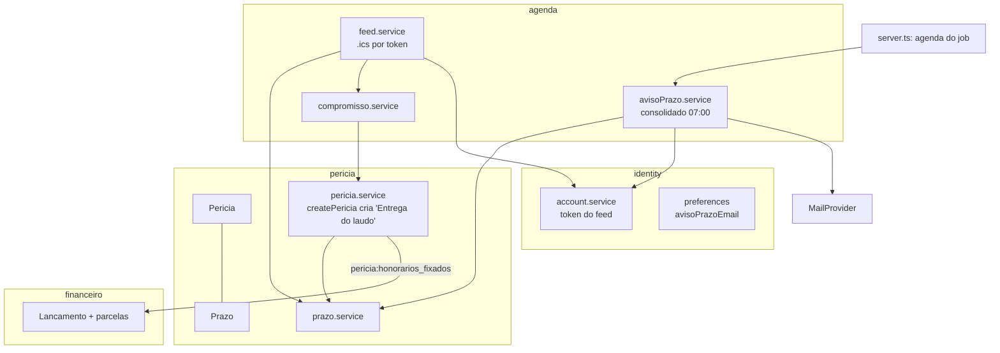

# Prazos e recebimentos — Design

**Spec**: `.specs/features/prazos-recebimentos/spec.md`
**Decisões**: AD-109 (Prazo), AD-110 (aviso por usuário), AD-111 (honorário com parcelas), AD-112 (sem migração)
**Status**: Approved (2026-10-31, usuário pediu para seguir direto)

---

## Architecture Overview



- **Prazo** (AD-109) vive no módulo `pericia` (`prazo.*`), com rotas sob `/pericias`. A perícia deixa de gravar `prazoLaudo`; o campo continua só na **entrada** de criação (`createPericiaSchema`, usado também pela conversão de oportunidade) e vira o prazo "Entrega do laudo" na mesma chamada do service. O evento `pericia:created` e `agenda.subscriber.ts` são removidos.
- **Agenda** ganha duas saídas que leem prazos e compromissos: o **feed iCal** (rota pública por token) e o **aviso diário por e-mail**. Os dois ficam em `agenda` porque são "a agenda vista de fora"; `agenda` passa a depender também de `identity` (grafo continua acíclico: `identity` e `pericia` não dependem de ninguém).
- **Financeiro** (AD-111): parcelas embutidas no `Lancamento`; status de receita recalculado no próprio update (pipeline de agregação, atômico), sem exclusão nem cancelamento de receita.

---

## Code Reuse Analysis

| Existente | Onde | Uso |
| --- | --- | --- |
| Padrão de módulo (router/controller/service/repository/schema) | `apps/api/src/modules/pericia/` | `prazo.*` segue o mesmo molde |
| `withPericiaNumero` / `findNumerosByIds` | `pericia.repository.ts`, `compromisso.service.ts`, `lancamento.service.ts` | vira `findResumosByIds` (número + partes), usado também pelo feed e pelo aviso |
| `wallClockToUtc`, `dateInDisplayTz` | `packages/db/src/time.ts` | próxima execução das 07:00 e "hoje" do aviso |
| `hashToken` | `packages/db/src/models/invite.model.ts` | token do feed guardado só como hash (mesmo padrão de sessão/convite) |
| `preferences` do usuário | `apps/api/src/modules/identity/preferences.*` | nova chave `avisoPrazoEmail` |
| `MailProvider` | `apps/api/src/providers/mail/` | envio do consolidado; nunca lança |
| `FormDialog`, `ProductSpecs`, `Panel`, `LinkList`, `ConfirmDialog`, campos de `form-fields` | `apps/web/src/components/` | diálogos de prazo, parcela, feed |
| `MonthView`/`TimeGridView` | `apps/web/src/routes/_private/agenda/@components/` | prazos entram como chips de dia inteiro |

---

## Components

### API — `pericia/prazo.*` (novo)

- **Rotas** (`canOperate`, todas tenant-scoped):
  - `GET /pericias/prazos?from&to` — prazos **pendentes** no intervalo `[from, to)` (calendário da agenda); sem intervalo, todos os pendentes.
  - `GET /pericias/:id/prazos` — todos os prazos da perícia, por vencimento crescente.
  - `POST /pericias/:id/prazos` — `{ titulo, vencimento, observacoes? }` → `pendente`.
  - `PATCH /pericias/prazos/:prazoId` — `{ titulo?, vencimento?, observacoes?, status?, protocoladoEm? }`. `status: protocolado` sem data grava hoje; voltar para `pendente`/`perdido` remove `protocoladoEm`.
  - `DELETE /pericias/prazos/:prazoId`.
- **Service** exporta também: `criarPrazoDoLaudo` (interno), `listPrazosPendentes(tenantId, range?)`, `listPrazosParaAviso(dias)` (todos os tenants, só sistema), `proximosPrazosByPericiaIds` (listagem), `deletePrazosDaPericia`.
- `PrazoRecord` traz `periciaNumero` (mesma junção `$in`).

### API — `pericia` (alterado)

- `createPericia`: grava sem `prazoLaudo` e, se veio, cria o prazo "Entrega do laudo" (observação "Gerado a partir do prazo do laudo").
- `listPericias`: cada item ganha `proximoPrazo?: { titulo, vencimento }` (uma agregação por página).
- `stats`: `prazo_vencido` e `prazo_proximo` passam a contar **prazos pendentes** (vencidos; vencendo em até 15 dias).
- `deletePericia`: apaga os prazos da perícia.
- `findNumerosByIds` → `findResumosByIds(tenantId, ids): Map<id, { numeroProcesso, autor?, reu? }>`.

### API — `agenda/feed.*` (novo)

- `GET /agenda/feed/:token.ics` — **sem sessão**; o token resolve `{ userId, tenantId }` via `accountService.findFeedOwner(hash)` (usuário ativo com papel, tenant não suspenso; senão 404). Responde `text/calendar; charset=utf-8` com:
  - compromissos **não cancelados** de 60 dias atrás a 365 dias à frente;
  - prazos **pendentes**, como evento de dia inteiro (`DTSTART;VALUE=DATE`, `DTEND` = dia seguinte).
  - `DESCRIPTION`: tipo, título, nº do processo, partes (`autor × réu`) e observações; `LOCATION`: local do compromisso (vazio no prazo). `UID` estável (`<id>@ethica`).
- Rate limit por IP (`express-rate-limit`, já dependência), para a rota pública.
- O `.ics` é montado à mão (RFC 5545: CRLF, escape de `\ ; , \n`, dobra de linha em 75 octetos) em `feed.service.ts` — sem biblioteca nova.

### API — `identity` (alterado)

- `User.calendarFeedTokenHash?: string` (índice único esparso).
- `POST /me/calendar-feed` — gera token novo (substitui o anterior = revoga) e devolve `{ token }` **uma vez**; `DELETE /me/calendar-feed` — revoga; `GET /me/calendar-feed` — `{ active: boolean }`.
- `preferences`: `avisoPrazoEmail` (default `true`); PATCH aceita qualquer subconjunto não vazio.
- `accountService.findFeedOwner(tokenHash)` e `accountService.listDestinatariosAvisoPrazo(tenantIds)` (usuários ativos, com papel, aviso ligado, tenant não suspenso).

### API — `agenda/avisoPrazo.service.ts` (novo)

- `enviarAvisosDePrazo(mail, now)`: hoje = `dateInDisplayTz(now)`; dias = `[hoje+15, hoje, hoje−1]`; busca os prazos pendentes desses dias em todos os tenants, agrupa por tenant, busca destinatários e manda **um e-mail por usuário** com três seções (vence em 15 dias, vence hoje, venceu ontem). Tenant sem prazo ou sem destinatário não gera e-mail.
- `proximaExecucao(now)`: próximo `07:00` de `America/Sao_Paulo` (`wallClockToUtc`).
- `server.ts` agenda com `setTimeout` encadeado (`agendarAvisosDePrazo`), só fora de teste; `buildMailProvider` sai de `app.ts` para ser reaproveitado.

### API — `financeiro` (alterado)

- `Lancamento.parcelas: { _id, valorCents, data, conta? }[]` (só receita). `LANCAMENTO_STATUS` ganha `parcial`; `cancelado` só para despesa.
- `POST /financeiro/lancamentos/:id/parcelas` — `{ valorCents, data, conta? }`; recusada com `422 parcela_excede_saldo` se passar do saldo (condição no próprio update, atômica).
- `DELETE /financeiro/lancamentos/:id/parcelas/:parcelaId` — estorno.
- `PATCH` de receita: recusa `status` (`422 honorario_status_derivado`) e `valorCents` abaixo do recebido (`422 valor_abaixo_do_recebido`); recalcula o status ao mudar o valor.
- `DELETE` de receita: `409 honorario_nao_pode_ser_excluido`.
- `lancarHonorariosFixados`: atualiza o valor do honorário fixado existente da perícia (se houver) em vez de criar outro.
- `resumo`/`fluxoMensal`: recebido = soma das parcelas pela data de cada uma; a receber = saldo das receitas abertas pelo vencimento; filtro `atrasado` = receita `previsto|parcial` vencida.
- Categoria `honorarios_parciais` é removida (era o contorno do recebimento parcial).

### Web

- `pericias/details`: painel **Prazos** (`@components/pericia-prazos.tsx`) com lista (status, vencimento, "vence em breve"/vencido, data de protocolo) e `FormDialog` de prazo (criar/editar), ações protocolar (data), marcar perdido, reabrir, excluir. A faixa do detalhe troca "prazo do laudo" por "próximo prazo".
- `pericias` (listagem): coluna "Próximo prazo" com destaque `vence em breve` (≤15 dias) e vencido.
- `pericias/add` e conversão de oportunidade: continuam com o campo "Prazo do laudo"; a edição perde o campo.
- `agenda`: consulta também `/pericias/prazos` do intervalo; chips de prazo de dia inteiro no mês e numa faixa "dia inteiro" no dia/semana; clique abre `PrazoDetail` (protocolar, perdido, ir para a perícia). Tipo `prazo` some do filtro.
- `financeiro/lancamentos`: receita mostra recebido/saldo e status `parcial`; ação "Registrar recebimento" (diálogo com valor sugerido = saldo, data = hoje, conta); no editar de receita, histórico de parcelas com "Estornar". Receita não tem cancelar.
- `account`: seção **Avisos e calendário**: liga/desliga "Aviso de prazos por e-mail" e o link do feed (gerar, copiar — mostrado uma vez —, revogar).
- Componentes compartilhados entre `pericias` e `agenda` (status/variant do prazo, diálogo de protocolo) sobem para `apps/web/src/components/prazo-*.ts(x)`; dados em `apps/web/src/query/prazo.ts`.

---

## Data Models

```ts
// packages/db/src/models/prazo.model.ts
interface PrazoDocument {
  _id: ObjectId;
  Tenant: ObjectId;
  Pericia: ObjectId;
  titulo: string;            // ≤160
  vencimento: string;        // YYYY-MM-DD (AD-103)
  status: 'pendente' | 'protocolado' | 'perdido';
  protocoladoEm?: string;    // YYYY-MM-DD, obrigatório quando protocolado
  observacoes?: string;      // ≤1000
  createdAt: Date; updatedAt: Date;
}
// índices: { Tenant, Pericia, vencimento }, { Tenant, status, vencimento }, { status, vencimento } (aviso entre tenants)

// Lancamento (receita)
parcelas: { _id: ObjectId; valorCents: number; data: string; conta?: string }[];
status: 'previsto' | 'parcial' | 'liquidado' | 'cancelado';   // parcial só receita; cancelado só despesa

// User
calendarFeedTokenHash?: string;
preferences.avisoPrazoEmail?: boolean;  // ausente = ligado
```

---

## Error Handling Strategy

| Cenário | Tratamento | Usuário vê |
| --- | --- | --- |
| Parcela maior que o saldo | `422 parcela_excede_saldo` (condição no update) | "A parcela é maior que o saldo a receber." |
| Excluir honorário | `409 honorario_nao_pode_ser_excluido` | mensagem; botão não aparece |
| Mudar status de honorário à mão | `422 honorario_status_derivado` | — (tela não oferece) |
| Valor do honorário abaixo do recebido | `422 valor_abaixo_do_recebido` | mensagem no formulário |
| Juízo reduz honorário abaixo do recebido | subscriber falha → `domain_event.handler_failed` no log; perícia salva | lançamento mantém o valor anterior |
| Token do feed inválido/revogado, usuário inativo, tenant suspenso | `404` | calendário externo para de atualizar |
| SMTP falha | `MailProvider` devolve `{sent:false}` e loga; job segue para o próximo | — |

---

## Risks & Concerns

| Concern | Location | Impact | Mitigation |
| --- | --- | --- | --- |
| Job em memória com `setTimeout`: várias réplicas da API mandariam e-mail duplicado; API fora do ar às 07:00 perde o dia | `apps/api/src/server.ts` | e-mail duplicado ou faltando | Hoje há uma réplica (`docker-compose.yml`); registrado no `feature.md` como pendência para quando houver mais de uma (trava por dia no banco) |
| Rota pública do feed | `agenda/feed.router.ts` | enumeração de token | token de 32 bytes aleatórios, só hash no banco, rate limit por IP, 404 indistinto |
| Redução do honorário pelo juízo abaixo do recebido só aparece no log | `events/subscribers/financeiro.subscriber.ts` | divergência silenciosa | mesma limitação aceita na AD-106; caso raro (valor recebido já é teto) |
| Testes do subscriber e do service da agenda dependem de `criarPrazoDoLaudo`/`pericia:created` | `apps/api/src/events/**/*.test.ts`, `compromisso.service.unit.test.ts` | quebra | reescritos sobre `pericia:honorarios_fixados` e `prazo.service` |

---

## Tech Decisions (feature-local)

| Decisão | Escolha | Por quê |
| --- | --- | --- |
| Prazos no calendário | Endpoint próprio `GET /pericias/prazos` consultado pela tela da agenda | Agenda não precisa fundir dois tipos na API; a tela junta |
| Formato do `.ics` | Gerado à mão | ~60 linhas; evita dependência para um subconjunto pequeno da RFC |
| Status da receita | Gravado e recalculado no mesmo update (pipeline) | Filtros/resumo continuam por `status`; atômico contra parcela concorrente |
| Token do feed | Só o hash no `User`; mostrado uma vez | Mesmo padrão de sessão e convite |
| Excluir prazo | Qualquer papel (`canOperate`) | Prazo é operacional (AD-107); perícia continua só admin |
